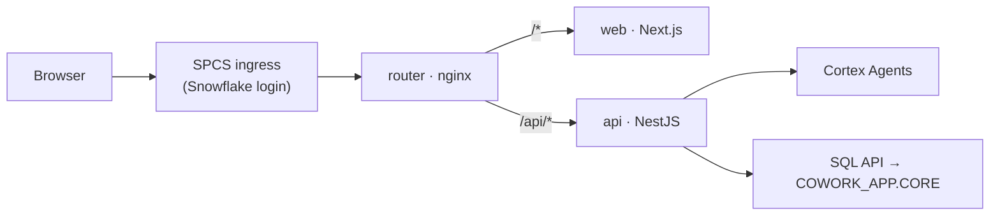

# CoWork: a Snowflake CoWork-style app on Cortex Agents

Chat with your Snowflake data through Cortex Agents, with streamed reasoning, SQL, tables and **charts** (including charts the
agent didn't draw), saved artifacts with live refresh, user memory, `/skills` and chat history. Built with Next.js +
NestJS and deployed on Snowpark Container Services.

**Live:** https://eaptzc-lbxplby-jj73300.snowflakecomputing.app · **Docs:** [docs/](docs/README.md)



## Quick start (offline, no Snowflake)

```bash
npm install
cp .env.example .env     # set AUTH_MODE=dev, CORTEX_MOCK=true, APP_STORE=file
npm run dev              # web :3000 · api :4000
```

Try "Show monthly revenue for 1997", "Top 10 customers by spend" (table only, so it gets auto-charted) and "I prefer bar charts" (memory).

## Repository

```
apps/web         Next.js UI          apps/api         NestJS API
packages/shared  shared TS logic     snowflake/       setup + SPCS SQL
docker/          Dockerfiles, nginx  deploy/spcs/     build_push.sh
docs/            documentation
```

## Documentation

1. [Architecture](docs/01-architecture.md): diagrams, Snowflake objects and roles, chat flow, chart pipeline
2. [Local development](docs/02-local-development.md): run modes, env reference, tests
3. [Snowflake setup](docs/03-snowflake-setup.md): setup scripts, agent grants, users
4. [SPCS deployment](docs/04-spcs-deployment.md): build, push, deploy, release
5. [Operations](docs/05-operations.md): health checks, troubleshooting, security

## Tests

```bash
npm test && npm run typecheck
```
