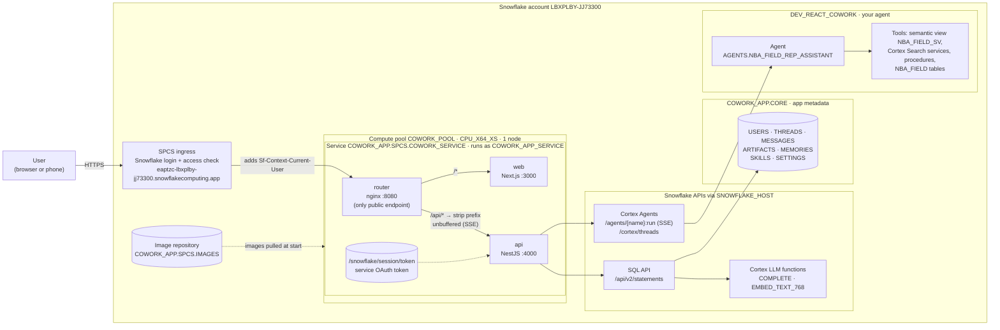
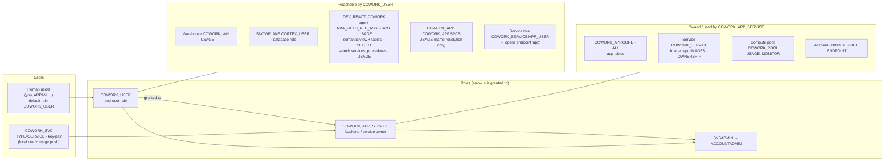
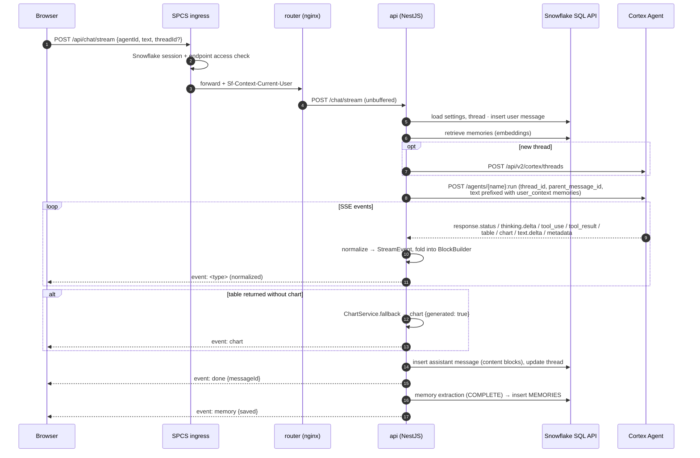
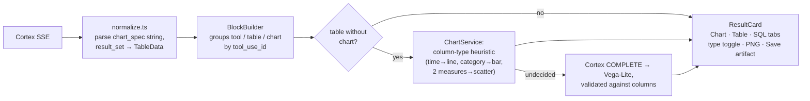

# 1. Architecture

CoWork is a self-hosted clone of Snowflake CoWork (formerly Snowflake Intelligence). It's a chat-first work agent over governed
Snowflake data. **Cortex Agents do all the reasoning.** The app adds the product around them: streaming chat with charts, saved
artifacts, user memory, skills and history. It's packaged as one Snowpark Container Services (SPCS) service.

## 1.1 Runtime architecture (production, SPCS)



Key points:

- **One public endpoint.** The `router` container is the only thing the ingress talks to. The browser loads pages and calls `/api/*` on the same origin, so there's no CORS and no cross-site cookies.
- **Containers share `localhost`** inside a service instance, which is how nginx reaches `web` and `api`.
- **Sign-in is Snowflake's.** The ingress logs the user in and checks endpoint access before any request reaches the app, then forwards the username in `Sf-Context-Current-User`. The API trusts that header in `AUTH_MODE=spcs`. The app has no passwords and no OAuth flow in production.
- **Snowflake access uses the service token.** SPCS mounts a short-lived OAuth token at `/snowflake/session/token` and refreshes it every few minutes. The API reads it on every call and talks to `https://$SNOWFLAKE_HOST`, which needs no external access integration.
- **Owner's rights.** Agent runs, SQL and LLM calls execute as the service owner role `COWORK_APP_SERVICE`, which inherits `COWORK_USER`. Every user of the app sees the same data. Per-user rights (caller's rights) is built in but off; see [§1.6](#16-auth-modes).

## 1.2 Snowflake objects, roles and grants



`COWORK_APP_SERVICE` inherits `COWORK_USER`, so the service can run the agent with everything users can reach.

| Object | Purpose |
|---|---|
| `COWORK_WH` (XS, auto-suspend 60s) | Warehouse for SQL API calls and agent tool execution |
| `COWORK_USER` | What people sign in as. Can reach the agent and its data, and open the app endpoint. Can't read `COWORK_APP.CORE` |
| `COWORK_APP_SERVICE` | Owns the service, image repo and app tables. Inherits `COWORK_USER` so the service can run the agent |
| `COWORK_SVC` | Service *user* with a key pair. Used by the API when running locally (`APP_STORE=snowflake`) and by `build_push.sh` to log in to the image registry |
| `COWORK_APP.CORE` | App metadata tables, created by the API on first start |
| `COWORK_APP.SPCS` | Image repository `IMAGES` and service `COWORK_SERVICE` |
| `COWORK_POOL` | CPU_X64_XS compute pool, 1 node, auto-suspend after 1h idle |
| `COWORK_OAUTH` | OAuth security integration, used **only for local development** (`AUTH_MODE=oauth`) |
| `DEV_REACT_COWORK` | Your data and agent (`AGENTS.NBA_FIELD_REP_ASSISTANT`, `NBA_FIELD.*`) |

> Endpoint access needs **both** the service role (`COWORK_SERVICE!APP_USER`) **and** USAGE on the database and schema that
> contain the service. Without the second, the ingress returns `ERROR_FORBIDDEN`. See [Operations](05-operations.md#ingress-error_forbidden).

## 1.3 Repository layout

```
apps/web         Next.js 15 (App Router) UI
apps/api         NestJS 11 API
packages/shared  TypeScript shared by both: stream events, BlockBuilder, chart heuristics, models
snowflake/       Setup SQL (01, 02, 04 optional, 05 SPCS)
docker/          api.Dockerfile, web.Dockerfile, router/ (nginx), docker-compose.yml (local Redis)
deploy/spcs/     build_push.sh
docs/            This documentation
```

### API modules (`apps/api/src`)

| Module | Responsibility |
|---|---|
| `auth/` | Auth modes `dev` / `oauth` / `spcs`, session guard, user settings |
| `snowflake/` | `SnowflakeClient`: SQL API + REST via `fetch`, credentials (OAuth, key-pair JWT, PAT, SPCS token) |
| `store/` | `DocStore` abstraction: `SnowflakeStore` (tables in `COWORK_APP.CORE`) or `FileStore` (`.data/db.json`, offline) |
| `cortex/` | Agent discovery, Cortex threads, `run()` streaming, SSE parser, **event normalizer**, offline mock agent |
| `chat/` | Streaming turn orchestration, thread and message CRUD, feedback, auto titles |
| `charts/` | **Chart fallback** when an agent returns a table without a chart |
| `memory/` | Memory extraction (LLM or rules), embeddings, retrieval, CRUD |
| `artifacts/` | Save, list, share and live-refresh charts and tables |
| `skills/` | `/command` saved prompts |
| `llm/` | `SNOWFLAKE.CORTEX.COMPLETE` and `EMBED_TEXT_768` wrappers, each with a non-LLM fallback |
| `common/` | Cache (Redis or in-memory), job queue (BullMQ or in-process), ids, AES-GCM crypto |

### Web (`apps/web/src`)

| Area | Files |
|---|---|
| Shell | `app/(app)/layout.tsx`, `components/Sidebar.tsx` |
| Chat | `components/ChatView.tsx`, `Composer.tsx` (slash skills, voice), `AgentPicker.tsx`, `Message.tsx` |
| Result rendering | `components/blocks/ResultCard.tsx` (Chart / Table / SQL tabs), `Reasoning.tsx`, `VegaChart.tsx`, `DataTable.tsx` |
| State | `lib/chat-store.ts` (live stream via Zustand), `lib/hooks.ts` (TanStack Query), `lib/sse.ts` |
| Pages | `/`, `/c/[id]`, `/artifacts`, `/artifacts/[id]`, `/skills`, `/settings`, `/login` |

## 1.4 A chat turn, end to end



The browser runs the **same `BlockBuilder`** (from `packages/shared`) over the live events, so a streamed answer and a
reloaded one render identically.

## 1.5 How charts work (the main gap in typical Cortex Agent clients)

Cortex Agents stream charts as their own SSE event, `response.chart`. Its `chart_spec` is a **Vega-Lite v5 spec serialized
as a string**, and tables arrive separately as `response.table` (a SQL-API style `result_set`). Clients that only read
`response.text.delta` lose both. CoWork handles each step:



- Native charts need the agent to have the `data_to_chart` tool plus an orchestration instruction to chart (see `snowflake/04_demo_agent.sql`).
- Charts are themed in `apps/web/src/lib/vega-theme.ts`: a fixed categorical palette, 2px lines, rounded bars capped at 24px, hairline grid, and separate light and dark steps.
- **Artifacts** store the spec, the table snapshot and the SQL. **Refresh** re-runs the SQL (cached `ARTIFACT_CACHE_TTL` seconds) and swaps fresh rows into the spec.

## 1.6 Auth modes

| `AUTH_MODE` | Who the user is | Snowflake credential | Used for |
|---|---|---|---|
| `dev` | Name typed on `/login` (session cookie) | Service user if configured, else none (pair with `CORTEX_MOCK=true`) | Offline development |
| `oauth` | Snowflake OAuth authorization-code flow (`COWORK_OAUTH`), refresh token AES-GCM encrypted in the cache | **The user's own OAuth token**, so each user's role applies | Local development against Snowflake |
| `spcs` | `Sf-Context-Current-User` header from the ingress | SPCS service token (owner's rights) | Production |

Caller's rights in SPCS (`SPCS_CALLER_RIGHTS=true`) sends `<service token>.<Sf-Context-Current-User-Token>` so queries run as
the signed-in user. It also needs `executeAsCaller: true` in the spec and `GRANT CALLER ...` privileges. It's implemented but
not enabled or verified.

## 1.7 Data model (`COWORK_APP.CORE`)

Every collection is a table with the same shape. Real columns hold ownership and parent lookups, and the document lives in `DATA`:

```sql
ID STRING PRIMARY KEY, USER_ID STRING, PARENT_ID STRING, DATA VARIANT,
CREATED_AT TIMESTAMP_NTZ, UPDATED_AT TIMESTAMP_NTZ
```

| Table | `PARENT_ID` | Document (`packages/shared/src/models.ts`) |
|---|---|---|
| `USERS` | – | `User` (id `u_<username>`) |
| `THREADS` | – | `Thread`: title, agentId, `cortexThreadId`, `lastCortexMessageId`, pinned |
| `MESSAGES` | thread id | `Message`: role, `content: ContentBlock[]`, feedback |
| `ARTIFACTS` | – | `Artifact`: type, title, spec, table, sql, sharedWith |
| `MEMORIES` | – | `Memory`: text, category, source, embedding (768-d) |
| `SKILLS` | – | `Skill`: name, prompt (`{{input}}`), description |
| `SETTINGS` | – | `UserSettings`: memoryEnabled, autoChart, defaultAgentId |

Standard tables (not hybrid tables, which trial accounts don't offer) behind a cache. Agent lists, user records, memories and
artifact refreshes are cached in Redis when `REDIS_URL` is set, or in memory otherwise.
