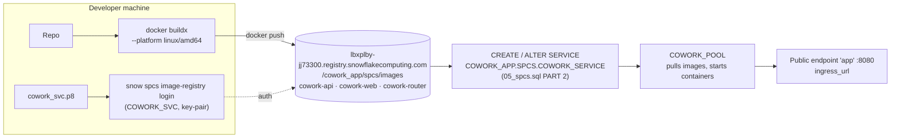

# 4. Deploying to Snowpark Container Services

**Live URL:** https://eaptzc-lbxplby-jj73300.snowflakecomputing.app

## 4.1 Deployment pipeline



## 4.2 Images

| Image | Dockerfile | Contents |
|---|---|---|
| `cowork-api` | `docker/api.Dockerfile` | Multi-stage: builds `@cowork/shared` + API, runtime has production deps only. `node apps/api/dist/main.js`, port 4000, runs as `node` |
| `cowork-web` | `docker/web.Dockerfile` | Next.js `output: 'standalone'` (traced from the repo root), built with `NEXT_PUBLIC_API_URL=/api`. `node apps/web/server.js`, port 3000 |
| `cowork-router` | `docker/router/Dockerfile` | `nginx:1.27-alpine` + `nginx.conf`, port 8080 |

The router (`docker/router/nginx.conf`):

- `/api/*` → `127.0.0.1:4000/` with the prefix stripped, `proxy_buffering off` and a 900s read timeout, so chat streams token by token
- `/*` → `127.0.0.1:3000`
- `/healthz` → 200, used as its readiness probe

`.dockerignore` excludes `.env`, `*.p8`, `*.pub`, `.data`, `.git` and all build output, so no secrets go into images.

SPCS runs `linux/amd64`. On Apple Silicon, `buildx` cross-builds under emulation, which takes about 10–15 minutes the first time.

## 4.3 Step by step

**Prereqs:** `01_setup.sql` and `02_remaining_setup.sql` done, Docker Desktop running, Snowflake CLI installed
(`brew install --cask docker`, `brew install snowflake-cli`).

**Step 1: Infrastructure** (`05_spcs.sql` PART 1, ACCOUNTADMIN)

```sql
GRANT ROLE COWORK_USER TO ROLE COWORK_APP_SERVICE;       -- service can run the agent
CREATE SCHEMA IF NOT EXISTS COWORK_APP.SPCS;
GRANT ALL ON SCHEMA COWORK_APP.SPCS TO ROLE COWORK_APP_SERVICE;
CREATE COMPUTE POOL IF NOT EXISTS COWORK_POOL
  MIN_NODES = 1 MAX_NODES = 1 INSTANCE_FAMILY = CPU_X64_XS AUTO_RESUME = TRUE AUTO_SUSPEND_SECS = 3600;
GRANT USAGE, MONITOR ON COMPUTE POOL COWORK_POOL TO ROLE COWORK_APP_SERVICE;
GRANT BIND SERVICE ENDPOINT ON ACCOUNT TO ROLE COWORK_APP_SERVICE;
USE ROLE COWORK_APP_SERVICE;
CREATE IMAGE REPOSITORY IF NOT EXISTS COWORK_APP.SPCS.IMAGES;
```

**Step 2: Build and push** (repo root)

```bash
./deploy/spcs/build_push.sh                 # TAG=v1 by default
# without the Snowflake CLI:
docker login lbxplby-jj73300.registry.snowflakecomputing.com -u <user>   # password, or a PAT if MFA
SKIP_LOGIN=1 ./deploy/spcs/build_push.sh
```

Verify with `SHOW IMAGES IN IMAGE REPOSITORY COWORK_APP.SPCS.IMAGES;`.

**Step 3: Create the service** (`05_spcs.sql` PART 2, as `COWORK_APP_SERVICE`)

The spec, abridged:

```yaml
spec:
  containers:
  - name: router   # /cowork_app/spcs/images/cowork-router:v1 · probe :8080/healthz
  - name: web      # cowork-web:v1 · PORT=3000 · probe :3000/login
  - name: api      # cowork-api:v1 · probe :4000/health
    env:
      AUTH_MODE: spcs
      APP_STORE: snowflake
      CORTEX_MOCK: "false"
      SNOWFLAKE_WAREHOUSE: COWORK_WH
      AGENT_LOCATIONS: DEV_REACT_COWORK.AGENTS
      LLM_MODEL: llama3.1-70b
  endpoints:
  - name: app
    port: 8080
    public: true
serviceRoles:
- name: app_user
  endpoints: [app]
```

Resources on the XS node: router 0.1 CPU / 128M, web 0.3 / 512M, api 0.5 / 1G (requests).

```sql
SELECT SYSTEM$GET_SERVICE_STATUS('COWORK_APP.SPCS.COWORK_SERVICE');   -- wait for 3× READY
SHOW ENDPOINTS IN SERVICE COWORK_APP.SPCS.COWORK_SERVICE;               -- ingress_url
```

**Step 4: Endpoint access** (`05_spcs.sql` PART 3)

```sql
USE ROLE ACCOUNTADMIN;
GRANT USAGE ON DATABASE COWORK_APP TO ROLE COWORK_USER;        -- required to resolve the service name
GRANT USAGE ON SCHEMA COWORK_APP.SPCS TO ROLE COWORK_USER;
USE ROLE COWORK_APP_SERVICE;
GRANT SERVICE ROLE COWORK_APP.SPCS.COWORK_SERVICE!APP_USER TO ROLE COWORK_USER;
```

Users whose **default role** is `COWORK_USER` can now open the URL and log in with Snowflake.

## 4.4 What changes inside SPCS (code)

| Concern | Local | SPCS |
|---|---|---|
| User identity | Session cookie (dev or OAuth) | `Sf-Context-Current-User` header (`AuthService.resolveSpcs`) |
| Snowflake base URL | `SNOWFLAKE_ACCOUNT_URL` | `https://$SNOWFLAKE_HOST` (injected) |
| Credential | User OAuth token / key-pair JWT | `/snowflake/session/token`, re-read on every call |
| Token header | `Authorization: Bearer …` + `X-Snowflake-Authorization-Token-Type` | Same. If Snowflake rejects it with 401, the client switches once to `Snowflake Token="…"` and logs a warning |
| Sign-out button | Shown | Hidden (Snowflake owns the session) |
| API URL in browser | `http://localhost:4000` | `/api` (same origin through the router) |

## 4.5 Releasing a new version

```bash
TAG=v2 ./deploy/spcs/build_push.sh
```

```sql
USE ROLE COWORK_APP_SERVICE;
ALTER SERVICE COWORK_APP.SPCS.COWORK_SERVICE FROM SPECIFICATION $$
  ... same spec as PART 2, with :v2 image tags ...
$$;
SELECT SYSTEM$GET_SERVICE_STATUS('COWORK_APP.SPCS.COWORK_SERVICE');
```

Always use a new tag. Re-pushing the same tag doesn't reliably make a running service pull again. The ingress URL stays the
same across upgrades.

## 4.6 Cost control: automatic start and stop (IST)

A service with a public endpoint can't use SPCS auto-suspend ("Auto suspend is not supported for services with public
endpoints"), and a compute pool can't suspend while a service runs on it. So `06_phase2.sql` PART B stops and starts
the service on purpose:

| When | What happens |
|---|---|
| 09:00 IST, Mon–Fri | Task `COWORK_START_WEEKDAYS` → `START_COWORK()` resumes the pool and service |
| 09:00–20:00 IST, Mon–Fri | Stays up (instant for users) |
| Any other time, every 15 min | Task `COWORK_IDLE_STOP` → `COWORK_IDLE_CHECK(60)`: if nobody used the app for 60 min, `STOP_COWORK()` suspends the service, then the pool (`AUTO_SUSPEND_SECS=300` as a backstop) |
| Automations, every 15 min | Same task: **starts** the app if an automation is due within 20 min, and **won't stop** it while a run is in progress or due within 30 min ([§7.4](07-research-dashboards-automations.md#74-automations)) |
| Whenever needed | Anyone with `COWORK_USER`: `CALL COWORK_APP.SPCS.START_COWORK();` in a Snowsight worksheet. Ready in about 3–5 min |

"Used" means any authenticated request. The API updates `COWORK_APP.CORE.ACTIVITY` (row `ID='app'`) at most every 5 minutes,
and `START_COWORK()` also touches it so a manual start gets a full idle window. Both tasks are serverless (no warehouse
wakes up) and run as `COWORK_APP_SERVICE`, which needs `EXECUTE TASK`, `EXECUTE MANAGED TASK` and `OPERATE` on the pool
(PART A).

```sql
SHOW TASKS IN SCHEMA COWORK_APP.SPCS;
CALL COWORK_APP.SPCS.COWORK_IDLE_CHECK(60);     -- what the task would do right now
ALTER TASK COWORK_APP.SPCS.COWORK_IDLE_STOP SUSPEND;   -- pause automation
```

To change hours, edit the CRON in `COWORK_START_WEEKDAYS` and the `HOUR()` window in `COWORK_IDLE_CHECK`.

### Manual control

```sql
ALTER SERVICE COWORK_APP.SPCS.COWORK_SERVICE SUSPEND;
ALTER COMPUTE POOL COWORK_POOL SUSPEND;
-- resume: pool first, then service
ALTER COMPUTE POOL COWORK_POOL RESUME;
ALTER SERVICE COWORK_APP.SPCS.COWORK_SERVICE RESUME;
```

The pool bills while it has an active node. `COWORK_WH` bills only while running queries (it auto-suspends after 60s).
