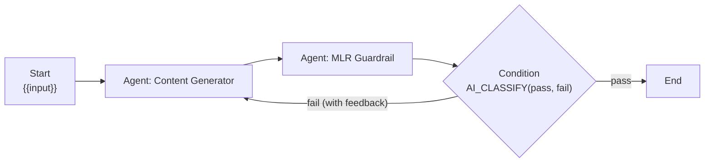

# 6. Workflows

Workflows combine **agents that already exist in Snowflake** into one chatbot. Nothing extra runs between agents except
condition nodes, which call `AI_CLASSIFY`. A published workflow shows up in the chat agent picker next to the agents.

## 6.1 Building blocks

| Node | What it does |
|---|---|
| **Start** | The user's message enters here and is available everywhere as `{{input}}` |
| **Agent** | Runs one Cortex agent. Its input is a template (see below). Output = the agent's answer text; its SQL, tables and charts are kept for display |
| **Condition** | Picks one branch. **AI_CLASSIFY** (default) or **keyword rules**. Each outgoing connection is assigned a branch, and a branch may point back to an earlier step (loop) |
| **Join** | Waits for every incoming branch, then passes their outputs on as one text with a heading per branch. Branches skipped by a condition don't block it |
| **End** | The final answer, a template (default `{{previous.output}}`) |

**Parallel** = draw several connections out of one node. **Sequential** = a chain. **Max steps** (default 12, max 50)
bounds total node executions, so loops always end.

### Templates

Plain text substitution, no logic:

| Variable | Value |
|---|---|
| `{{input}}` | The user's original message |
| `{{previous.output}}` | Output of the step that triggered this one |
| `{{nodes.<id>.output}}` | Latest output of a specific step (empty if it hasn't run yet, which handles the first pass of a loop) |

Example, the generator in a review loop: `{{input}}\n\nIf reviewer feedback follows, revise to address every point:\n{{nodes.reviewer.output}}`.

## 6.2 Execution



- `WorkflowExecutor` (`apps/api/src/workflows/workflow-executor.ts`) schedules nodes as their inputs arrive, runs fan-out branches concurrently, and streams `node_start` / `node_event` (the agent's own SSE events, wrapped) / `node_end` with outputs and decisions.
- Each agent node is a stateless `:run` call. Workflows don't use Cortex threads, chat memory or prior turns. Each chat message runs the graph fresh.
- Tables without a chart get the same auto-chart fallback as normal chat.
- A failing agent marks its step as an error and stops that branch. Other branches continue.
- Condition decisions: `AI_CLASSIFY(text, branches, {task_description})`. Offline, or if it errors, keyword rules apply, then the branch name mentioned first in the text, then the default/last branch. **Snowflake Decision / Decision Fast** (private preview, not enabled on this account) plug into `LlmService.classify` when available.

## 6.3 Using it

1. **Workflows** page → *Agents in Snowflake*: **Try** sends one message to an agent and shows exactly what a next step would receive. **Chat** opens a normal chat with it.
2. Start from a template (**Sequential**, **Parallel**, **Conditional review loop**) or **New workflow**.
3. On the canvas: **+ Agent / Condition / Join / End**, drag between dots to connect, select a step to edit it on the right. Insert template variables with the chips under each template field.
4. **Test run** on the right runs the current (even unsaved) graph. Steps light up on the canvas, with a ×N badge for loops.
5. **Publish** (requires a valid graph). Others see it in the chat agent picker as a workflow, with the step trace above the answer.

Only the owner can edit a workflow. Everyone can run published ones.

## 6.4 Restricting who can build

Building (create, edit, publish, test runs, **Try**) goes through `PermissionsService`. Today `WORKFLOW_BUILDER_ROLE` is
empty, so everyone can build. To restrict:

```sql
USE ROLE ACCOUNTADMIN;
CREATE ROLE IF NOT EXISTS COWORK_BUILDER;
GRANT ROLE COWORK_BUILDER TO USER <builder>;
GRANT ROLE COWORK_BUILDER TO ROLE COWORK_APP_SERVICE;   -- lets the app read its members
```

Then set `WORKFLOW_BUILDER_ROLE: COWORK_BUILDER` in the service spec and `ALTER SERVICE` (see `06_phase2.sql` PART C).
Membership is read with `SHOW GRANTS OF ROLE` (direct user grants) and cached for 5 minutes. Non-builders keep chatting
with published workflows; the builder UI becomes read-only for them.

## 6.5 New agents appear automatically

`06_phase2.sql` PART A grants `USAGE ON ALL / FUTURE AGENTS IN SCHEMA DEV_REACT_COWORK.AGENTS` plus future grants on the
tables, views, semantic views, search services, procedures and functions in `NBA_FIELD`. A new agent in that schema shows up
in the app within about 5 minutes (the agent list cache). Add the same tool-schema grants for any new schema your agents read.
Avoid `CREATE OR REPLACE AGENT ... COPY GRANTS`, which skips future grants.
