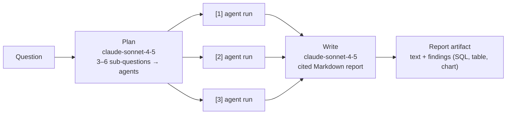
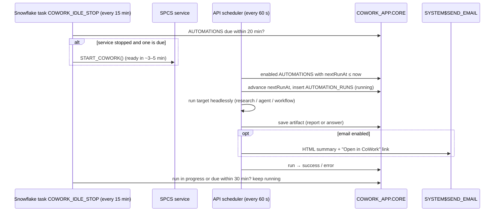

# 7. Deep research, dashboards, automations and export

## 7.1 Deep research

Turn it on with **+ → Deep research** in the message box. The selected agent decides the scope:

| Agent picker | Research uses |
|---|---|
| **Auto** (default when several agents exist) | The planner assigns each sub-question to the best agent, judged from agent descriptions and sample questions |
| A specific agent | Only that agent, for every sub-question |
| A workflow | Treated as Auto |

- `ResearchService` (`apps/api/src/research/research.service.ts`): `SNOWFLAKE.CORTEX.COMPLETE(RESEARCH_MODEL, …)` plans, sub-questions run **3 at a time** against the agents (with auto-charting), and the writer cites findings as `[n]`.
- Progress streams as research steps, so chat shows a **Deep research** trace with one row per sub-question (expand to see the agent's answer, SQL, table and chart), followed by the report and a card linking to the saved **Report** artifact.
- If the model is unavailable, the plan falls back to simple variations and the report to an assembled list of findings, so research still completes.
- Give each agent a one-line `COMMENT` describing what it covers. The planner relies on it (`TEST_AGENT` currently has none).

**Report artifacts** show the written report with clickable citations, then **Sources**: each finding's question, agent, chart or table, answer and SQL. **Refresh** re-runs every finding's SQL under the viewer's role and keeps the text.

## 7.2 Auto agent selection in normal chat

With **Auto** selected and Deep research off, each question goes to one agent chosen by `AI_CLASSIFY` over the agents'
names and descriptions (`AgentRouter`). The status line shows "Asking <agent>". Auto threads don't use Cortex threads
because the agent can change between turns; prior turns are sent as history instead.

## 7.3 Dashboards

- **Artifacts → Dashboards → New dashboard**, or **Add to dashboard** on any chart or table artifact.
- A 12-column grid (`react-grid-layout`). **Edit** to drag (handle), resize (corner) and remove tiles. **Done** saves the layout.
- Opening a dashboard loads live data through the artifact cache (`ARTIFACT_CACHE_TTL`). **Refresh all** forces fresh queries.
- **Share** works like artifacts (usernames or everyone). Viewers only see tiles whose artifacts they can open.
- Stored in `COWORK_APP.CORE.DASHBOARDS` (`items: [{artifactId, x, y, w, h}]`).

## 7.4 Automations

**Automations** page → **New automation**: name, what runs (**Deep research**, **Agent** with Auto allowed, or a published
**Workflow**), the message, a schedule in **IST** (every day / weekdays / weekly / custom cron, at most every 15 min) and
optional email recipients.

### Creating automations from chat

- **Automate this:** the calendar icon under any answer (and **Automate** on report and answer artifacts) opens the automation form pre-filled with that question, agent (or Auto) and mode (deep research if the answer was a report).
- **Ask in chat:** e.g. *"send me this every Monday at 8am to me@company.com"*. Messages that look like scheduling (recurrence and action words) are checked by `AutomationIntentService` with `RESEARCH_MODEL`. "This/that" resolves to the previous question, and kind follows the previous answer (report → deep research). Chat replies with a **confirmation card** (name, what runs, schedule in IST, recipients) with **Create automation** or **Edit first**. Nothing is scheduled until you confirm. Ordinary questions ("revenue every month in 1997") are not treated as schedules. Offline, a rule-based parser (`parseScheduleText`) does the extraction.

### How a run happens

- **Late starts:** due runs execute even if the app came up a few minutes late. Over 6 hours late, they're recorded as **missed** and rescheduled, so there's no backlog flood.
- **Restarts:** runs left `running` by a restarted process are closed as errors on start-up.
- **Credentials:** runs use the app's service identity (owner's rights): the SPCS token in production, `COWORK_SVC` locally.
- **Run now** executes immediately (the button waits for the result). **History** lists runs with status, duration, email flag and a link to the result.
- **Tables:** `AUTOMATIONS`, `AUTOMATION_RUNS` (`PARENT_ID` = automation id).

### Email

`CALL SYSTEM$SEND_EMAIL('COWORK_EMAIL', recipients, subject, html, 'text/html')` with the notification integration from
`06_phase2.sql` A5. **Snowflake only delivers to verified email addresses of users in this account.** Each recipient
verifies theirs in Snowsight (profile → email → verify). The email has the report text (Markdown rendered to HTML) and
an **Open in CoWork** button (`APP_PUBLIC_URL`). Charts stay in the app.

## 7.5 Export

| Where | PDF | PowerPoint |
|---|---|---|
| Report | ✅ | Title, one slide per report section, one chart (or table) slide per finding |
| Chart / table / answer artifact | ✅ | Title + chart or table (+ summary) |
| Dashboard | ✅ | Title + one slide per tile, in grid order |

- **PDF** uses the browser's print dialog (*Save as PDF*). Print CSS hides navigation and lets content flow across pages; charts stay vector.
- **PowerPoint** is generated in the browser with `pptxgenjs` (16:9). Charts are rendered off-screen to PNG with the app's chart theme.

## 7.6 Configuration

| Variable | Default | Purpose |
|---|---|---|
| `RESEARCH_MODEL` | `claude-sonnet-4-5` | Planning and writing for deep research |
| `EMAIL_INTEGRATION` | `COWORK_EMAIL` | Notification integration for `SYSTEM$SEND_EMAIL` |
| `APP_PUBLIC_URL` | `WEB_ORIGIN` | Links in emails (SPCS: the ingress URL) |

Models available on this account (checked 2026-10-24): `claude-sonnet-4-5`, `llama3.3-70b`, `llama3.1-70b`. Snowflake
Decision models aren't enabled yet; conditions and Auto routing use `AI_CLASSIFY`.
